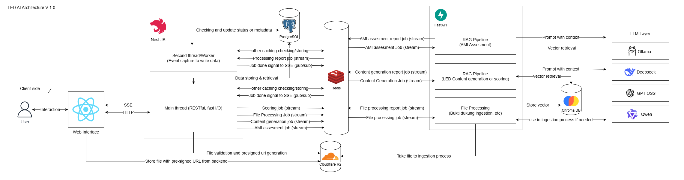

# Dokumentasi Arsitektur Sistem — Platform Penyusunan Dokumen LED LAM-Teknik

> **Revisi 2026-09-22.** Dokumen ini menggantikan rancangan awal. Prinsip yang berubah beserta alasannya dicatat di [bagian 12](#12-riwayat-perubahan-rancangan). Rancangan di bagian 1–8 adalah **arah yang sudah diputuskan**. Kondisi kode saat ini belum sepenuhnya mengikutinya; selisihnya dicatat di [bagian 9](#9-status-implementasi-terhadap-rancangan). Usulan yang belum dikonfirmasi dan hal yang belum diputuskan dipisah di [bagian 10](#10-usulan-yang-belum-dikonfirmasi) dan [bagian 11](#11-hal-yang-belum-diputuskan).

## Daftar Isi

1. [Gambaran Umum & Prinsip](#1-gambaran-umum--prinsip)
2. [Diagram Arsitektur](#2-diagram-arsitektur)
3. [Komponen Sistem](#3-komponen-sistem)
4. [Kepemilikan Data](#4-kepemilikan-data)
5. [Aturan Komunikasi Antar Komponen](#5-aturan-komunikasi-antar-komponen)
6. [Alur Kerja Utama](#6-alur-kerja-utama)
7. [Chat & Revisi Konten](#7-chat--revisi-konten)
8. [Model Eksekusi Worker & Scaling](#8-model-eksekusi-worker--scaling)
9. [Status Implementasi terhadap Rancangan](#9-status-implementasi-terhadap-rancangan)
10. [Usulan yang Belum Dikonfirmasi](#10-usulan-yang-belum-dikonfirmasi)
11. [Hal yang Belum Diputuskan](#11-hal-yang-belum-diputuskan)
12. [Riwayat Perubahan Rancangan](#12-riwayat-perubahan-rancangan)
13. [Autentikasi, Keamanan, & Logging](#13-autentikasi-keamanan--logging)

---

## 1. Gambaran Umum & Prinsip

Sistem terdiri dari **backend NestJS** sebagai pemilik seluruh state domain dan pintu masuk client, serta **AI worker Python** yang mengerjakan pekerjaan AI yang panjang dan berat. Keduanya berkomunikasi lewat **antrean job BullMQ di Redis**.

Prinsip utamanya satu kalimat:

> **Backend = pemilik seluruh state domain. AI worker = compute + pemilik tabel vektor.**

Turunannya:

1. **Worker boleh membaca tabel domain, tapi hanya menulis tabel vektor** (`*_chunk_embeddings`). Hasil generasi, skoring AMI, dan status ingestion dikirim balik ke backend, lalu **backend yang menulisnya**. Alasannya: skema dikelola dari satu pintu (Prisma), sehingga perubahan skema tidak diam-diam mematahkan penulis lain.
2. **Worker tidak melayani CRUD atau baca domain untuk client.** Semua data domain yang dibutuhkan client disajikan backend langsung dari Postgres, tanpa hop tambahan client → backend → worker.
3. **Semua upload berkas: client → R2 langsung.** Backend hanya menerbitkan presigned URL dan memverifikasi berkas, lalu mengirim job berisi **file key**. Worker mengunduh sendiri dari R2. Tidak ada endpoint upload di backend maupun di sisi AI.
4. **Cakupan AI worker: ingestion, generasi konten, dan skoring AMI.** Chat bukan tugas worker; chat dimiliki backend (lihat [bagian 7](#7-chat--revisi-konten)).

---

## 2. Diagram Arsitektur



> Gambar di atas masih rancangan awal (ChromaDB, "Second Thread", Redis Streams) dan belum diperbarui. Gambaran terkini:

```
                    ┌───────────────────── Client (React SPA) ─────────────────────┐
                    │  HTTP (CRUD, aksi, chat)      SSE (status job)    PUT berkas │
                    └──────────┬──────────────────────────┬───────────────┬────────┘
                               │                          │               │ presigned URL
                               ▼                          │               ▼
┌──────────────────────── Backend (NestJS) ───────────────┴──┐     ┌───────────────┐
│ REST API · validasi · auth · tenant                         │     │ Cloudflare R2 │
│ Chat agent (LLM cepat + tool calling)                       │     └───────▲───────┘
│ Penerima laporan hasil job → tulis tabel domain             │             │ unduh by file key
│ Relay status job → SSE                                      │             │
└───────┬─────────────────────────────┬───────────────────────┘             │
        │ Prisma (baca/tulis domain)  │ enqueue job / terima hasil          │
        ▼                             ▼                                     │
┌──────────────────┐        ┌───────────────── Redis ─────────────────┐     │
│ PostgreSQL       │        │ BullMQ: generation · assessment ·       │     │
│ + pgvector       │        │         ingestion (+ laporan hasil)     │     │
└───────▲──────────┘        │ lock / cache                            │     │
        │                   └──────────────────┬──────────────────────┘     │
        │ baca domain                          ▼                            │
        │ tulis vektor only   ┌──── AI Worker: Ingestion (terpisah) ───────┐│
        ├─────────────────────┤ MinerU, chunk, embed · batas CPU/RAM       ├┘
        │                     └────────────────────────────────────────────┘
        │                     ┌──── AI Worker: Generasi · AMI ─────────────┐
        └─────────────────────┤ satu service, atau dua (opsional)          │
                              └──────────────────┬─────────────────────────┘
                                                 ▼
                                        LLM (OpenRouter)
```

---

## 3. Komponen Sistem

### 3.1 Client (Web)

- React (React Router SPA).
- **HTTP** ke backend untuk seluruh transaksi, termasuk chat.
- **SSE** dari backend untuk status job (progres, selesai, gagal).
- **Upload berkas langsung ke R2** lewat presigned URL. Byte berkas tidak pernah melewati backend maupun worker.

### 3.2 Backend (NestJS)

Satu service dengan beberapa modul; istilah "Main Thread / Second Thread" di rancangan awal tidak dipakai lagi karena Node berjalan di satu thread — yang ada adalah modul/listener berbeda dalam proses yang sama.

- **REST API**: autentikasi, CRUD tenant/prodi/dokumen/bab, validasi bisnis (kunci bab, role).
- **Pengirim job**: satu pintu `JobsService.enqueue()` → BullMQ, sekaligus mencatat baris audit `Job` di Postgres. Response ke client langsung dibalas tanpa menunggu job selesai.
- **Penerima laporan hasil job**: menerima hasil dari worker, memvalidasi, lalu **menulis ke tabel domain**. Backend adalah satu-satunya penulis tabel domain.
- **Relay SSE**: meneruskan event status job ke client yang relevan.
- **Chat agent**: endpoint chat, riwayat chat, pemanggilan LLM, dan tool calling yang men-dispatch job ke worker (lihat [bagian 7](#7-chat--revisi-konten)).
- **R2**: menerbitkan presigned URL dan memverifikasi keberadaan berkas.

### 3.3 Redis

- **BullMQ**: antrean `generation-queue`, `assessment-queue`, `ingestion-queue` (+ jalur laporan hasil, lihat [bagian 10](#10-usulan-yang-belum-dikonfirmasi)).
- **Event status job** (`QueueEvents` BullMQ) untuk SSE. Event ini bersifat broadcast ke semua listener, jadi tetap benar saat backend dijalankan multi-instance.
- **Lock & cache**: auto-lock kolaborasi bab (`lock:bab:{bab_id}`, sliding window 10 menit), flag pembatalan job, dan cache lain yang sifatnya sementara dan boleh hilang.

### 3.4 PostgreSQL + pgvector

- Database tunggal untuk seluruh skema aplikasi, dikelola lewat **Prisma** (skema & migrasi hanya dari satu tempat).
- **pgvector** menyimpan embedding (menggantikan ChromaDB di rancangan awal): satu komponen infra lebih sedikit, dan filter tenant cukup lewat SQL biasa.
- Hak tulis: backend untuk tabel domain; AI worker hanya untuk tabel vektor.

### 3.5 Cloudflare R2

- Object storage untuk seluruh berkas mentah (LED, bukti dukung, panduan, rubrik).
- Client upload langsung; worker mengunduh langsung berdasarkan file key dari payload job.

### 3.6 AI Worker (Python)

Konsumen BullMQ untuk tiga jenis pekerjaan:

| Antrean | Pekerjaan |
|---|---|
| `ingestion-queue` | Ekstraksi berkas (MinerU untuk PDF), chunking, embedding → tulis ke tabel vektor |
| `generation-queue` | Generasi konten sub-bab, outline, rekomendasi, simulasi skor |
| `assessment-queue` | Skoring AMI per dokumen (seluruh indikator); **setor ke LED** (`SETOR_LED`): mengisi tabel analisis IKU di LED (Evaluasi + narasi), hasilnya dikembalikan sebagai return value job dan dibaca lewat `GET /jobs/:id` |

- Dijalankan sebagai **beberapa service dari image yang sama**, masing-masing mendengarkan antrean tertentu: worker ingestion **wajib** terpisah, worker generasi dan AMI boleh digabung atau dipisah (lihat [bagian 8.2](#82-pemisahan-worker-per-jenis-pekerjaan)).
- **Membaca** tabel domain untuk menyusun prompt (rubrik, template, isi section, tag bukti) — diizinkan.
- **Menulis** hanya tabel vektor. Hasil lain dikirim sebagai laporan ke backend.
- Tidak menyimpan state di memori proses yang dibutuhkan setelah job selesai.

### 3.7 LLM Layer

- Diakses lewat **OpenRouter** (satu API, banyak model). Model per peran diatur lewat env: generasi, judge, dan (baru) model chat.
- Model reasoning (misalnya `deepseek-r1`) untuk generasi/penilaian yang berat; model cepat non-reasoning untuk chat dan revisi ringan.

---

## 4. Kepemilikan Data

| Jenis data | Pemilik tulis | Pembaca |
|---|---|---|
| Tabel domain (tenant, prodi, dokumen, bab, section, draft, hasil AMI, rubrik, template, bukti dukung, chat, job) | **Backend** | Backend, AI worker (baca) |
| Tabel vektor (`*_chunk_embeddings`) | **AI worker** | AI worker, (opsional) backend |
| Berkas mentah | Client (via presigned URL) | AI worker, backend (verifikasi) |
| Lock, cache, flag pembatalan | Backend (dan worker untuk flag yang ia baca) | Keduanya |

Skema seluruh tabel — termasuk tabel vektor — tetap didefinisikan di Prisma. Worker tidak membuat atau mengubah skema.

---

## 5. Aturan Komunikasi Antar Komponen

Rancangan awal menyatakan backend dan AI **tidak pernah** berkomunikasi langsung. Aturan itu terlalu mutlak; penggantinya:

| Jenis interaksi | Jalur | Contoh |
|---|---|---|
| Pekerjaan panjang/berat/memanggil LLM berulang | **Antrean BullMQ**, hasil dilaporkan balik ke backend | Generasi, AMI, ingestion |
| Baca/CRUD data domain | **Backend langsung ke Postgres** — tidak lewat AI | Daftar indikator, hasil evaluasi, riwayat chat, pratinjau struktur |
| Upload berkas | **Client → R2**, lalu job berisi file key | LED, bukti dukung, panduan |
| Notifikasi status | **SSE** dari backend (sumber: event BullMQ) | Progres dan selesai job |

---

## 6. Alur Kerja Utama

### 6.1 Upload & Ingest Berkas (LED, Bukti Dukung, Panduan, Rubrik)

```
1. Client minta izin upload → backend validasi & terbitkan presigned URL
2. Client upload LANGSUNG ke R2
3. Client beri tahu backend bahwa upload selesai
4. Backend verifikasi berkas di R2 (HEAD, opsional cocokkan ukuran)
   → gagal: tandai status GAGAL, tidak ada job
5. Backend enqueue job ingestion berisi file key → balas cepat ke client
6. Worker ambil job → unduh dari R2 → ekstraksi, chunking, embedding
   → tulis tabel vektor
7. Worker laporkan hasil (status, jumlah chunk, metadata) ke backend
8. Backend tulis status/metadata ke tabel domain → event SSE ke client
```

Semua jenis berkas memakai alur yang sama; tidak ada jalur khusus per jenis berkas.

### 6.2 Generasi Konten

```
1. Client klik Generate (per sub-bab) → backend validasi (kunci bab, role)
2. Backend enqueue job generasi → balas cepat; client mendengar SSE
3. Worker: baca konteks domain + retrieval vektor → prompt ke LLM
   → hasil generasi + skor kualitas (judge)
4. Worker laporkan hasil ke backend
5. Backend tulis draft/section, tautan bukti, skor kualitas → SSE ke client
```

### 6.3 Skoring AMI

```
1. Dipicu manual (tombol penilaian) → backend enqueue job AMI
2. Worker menilai seluruh indikator dokumen (beberapa indikator paralel dalam satu job)
3. Worker laporkan hasil ke backend
4. Backend tulis hasil indikator & langkah reasoning → SSE ke client
```

Cara pelaporan (sekali di akhir atau bertahap per indikator agar UI bisa menampilkan progres) belum diputuskan — lihat [bagian 10](#10-usulan-yang-belum-dikonfirmasi) no. 1.

### 6.4 Notifikasi Real-time (SSE)

Backend berlangganan event BullMQ (`progress`, `completed`, `failed`) per antrean, lalu meneruskan event milik job tertentu ke client yang membuka job tersebut. Event ini hanya **notifikasi**; data utamanya selalu dibaca dari Postgres, sehingga event yang terlewat tidak menghilangkan data.

---

## 7. Chat & Revisi Konten

### 7.1 Chat di backend

- Endpoint chat, riwayat, otorisasi, dan kunci bab dikelola **backend**.
- Backend memanggil LLM **cepat** (non-reasoning, mendukung tool calling) sehingga chat tetap responsif.
- Chat **tidak menunggu** generasi: permintaan yang butuh pekerjaan berat di-dispatch sebagai job lewat tool calling, lalu chat langsung menjawab bahwa prosesnya sedang berjalan. UI menampilkan loading di latar belakang selama job berjalan.
- Selama job masih berjalan, **tool calling dinonaktifkan sementara** agar tidak ada job ganda. (Alternatif penjaga di sisi server: [bagian 10](#10-usulan-yang-belum-dikonfirmasi) no. 4.)

### 7.2 Revisi bertingkat

Revisi dibedakan berdasarkan kebutuhannya, karena biayanya berbeda jauh:

| Jenis revisi | Jalur | Alasan |
|---|---|---|
| Ganti kata, kalimat, paragraf; ubah tone; ubah panjang | **Agentic loop di backend**, prompt ulang tanpa injeksi bukti dukung | Input kecil (paragraf + instruksi), selesai dalam hitungan detik, biaya sangat kecil |
| Ganti atau tambah bukti dukung | **Job ke AI worker** (retrieval + prompt lengkap) — atau diarahkan ke fitur generasi ulang di luar chat | Butuh retrieval dan prompt besar; menit, bukan detik |

- Penentuan jenis revisi dilakukan oleh **intent resolver** sebelum routing.
- Revisi tanpa bukti memakai **system prompt ketat**: boleh mengubah tone, jumlah karakter, dan struktur kalimat; **tidak boleh** mengubah angka, fakta, atau klaim.

---

## 8. Model Eksekusi Worker & Scaling

### 8.1 Slot, `concurrency`, dan instance

- **Slot job paralel = jumlah instance worker × `concurrency` per instance.** Waktu antre user ditentukan oleh jumlah slot ini; response time per job ditentukan oleh LLM provider.
- **`concurrency`** BullMQ = jumlah job yang dipegang satu proses sebagai coroutine asyncio dalam satu event loop — **bukan** jumlah thread. Karena job generasi/AMI sebagian besar menunggu LLM (I/O), satu proses bisa memegang banyak job sekaligus dengan satu salinan model embedding di memori.
- **Instance** tambahan memberi isolasi (crash/beku hanya berdampak ke job di instance itu), memakai lebih banyak core CPU, dan memungkinkan restart bergiliran — dengan biaya RAM per instance (model embedding dimuat per proses).
- Susunan yang dituju: **beberapa instance × `concurrency` moderat**. Pembedaan `concurrency` per antrean masih usulan ([bagian 10](#10-usulan-yang-belum-dikonfirmasi) no. 12).
- Total slot perlu **dibatasi sesuai kapasitas provider LLM**, bukan dibuat sebanyak mungkin. Antrean dalam batas wajar berfungsi sebagai penyangga agar provider tidak kebanjiran.
- **Auto-scaling** (bila nanti diperlukan lintas mesin) harus berbasis **panjang antrean**, bukan CPU, karena worker hampir selalu menganggur CPU-nya saat menunggu LLM. Docker Compose sendiri tidak punya auto-scaling.

### 8.2 Pemisahan worker per jenis pekerjaan

Ketiga jenis pekerjaan AI punya sifat beban yang berbeda, dan sifat beban itulah yang menentukan perlu dipisah atau tidak — bukan jumlah jenis pekerjaannya.

| Pekerjaan | Sifat beban | Sumber daya yang dibutuhkan |
|---|---|---|
| Ingestion | **CPU/RAM-bound** — ekstraksi PDF (MinerU: layout + OCR) memakai CPU penuh dan RAM melonjak ±2–4 GB per berkas; embedding chunk juga memakai CPU | vCPU dan RAM |
| Generasi LED | **I/O-bound** — hampir seluruh waktunya menunggu jawaban LLM | Slot job |
| Skoring AMI | **I/O-bound** — sama seperti generasi, dengan jauh lebih banyak panggilan LLM per job; tiap indikator yang sedang dinilai memakai satu thread | Slot job dan thread |

**Aturan:**

1. **Ingestion WAJIB berjalan di worker terpisah** yang hanya mendengarkan `ingestion-queue`, dengan batas CPU/RAM sendiri.
2. **Generasi LED dan skoring AMI BOLEH digabung** dalam satu worker, atau **dipisah** bila memenuhi kondisi di bawah (opsional).
3. Pemisahan **tidak membuat codebase baru**: semua worker memakai **image yang sama**, dan tiap container menentukan antrean yang didengarkan lewat env (misalnya `WORKER_QUEUES`). Pemisahan = beberapa service di compose/orkestrator, masing-masing dengan batas sumber daya dan jumlah replika sendiri.

**Kenapa ingestion wajib dipisah:**

- **Tidak membekukan pekerjaan lain.** Ekstraksi berjalan lama (hingga menit per berkas) dan intensif CPU. Bila berbagi proses atau event loop dengan generasi dan AMI, job-job yang sedang menunggu LLM ikut tertahan selama ekstraksi berjalan.
- **Lonjakan RAM tidak merembet.** Tanpa batas memori tersendiri, beberapa berkas yang diekstrak bersamaan bisa menghabiskan RAM host dan membuat komponen lain (Postgres, backend) dimatikan oleh OOM killer. Dengan container terpisah, yang terkena hanya worker ingestion.
- **Cara scaling-nya berbeda.** Ingestion diskalakan dengan **menambah vCPU/instance** (atau GPU); generasi dan AMI diskalakan dengan **menambah slot** (`concurrency`) karena CPU-nya menganggur. Digabung, keduanya tidak bisa diatur sesuai kebutuhan masing-masing.
- **Pola lonjakannya berbeda.** Upload massal (misalnya awal siklus akreditasi) datang bergelombang dan tidak boleh membuat penyusun yang sedang generate ikut menunggu.
- **Kebutuhan hardware bisa berbeda di masa depan** — misalnya worker ingestion di mesin ber-GPU, sementara generasi/AMI tetap di mesin kecil.

**Opsional — memisahkan generasi LED dan skoring AMI.** Menggabungkan keduanya tidak berat, karena sama-sama menunggu jaringan. Pisahkan bila salah satu kondisi berikut muncul:

- **Isolasi kegagalan**: job AMI berjalan lama (puluhan menit per dokumen); restart/crash worker AMI tidak boleh ikut menghentikan generasi yang sedang dikerjakan penyusun, dan sebaliknya.
- **Scaling berbeda**: generasi dipakai jauh lebih sering (banyak klik kecil), AMI jarang tapi berat — misalnya generasi 3 replika, AMI 1 replika.
- **Batas beban ke provider LLM**: AMI menghasilkan jauh lebih banyak panggilan LLM bersamaan; worker tersendiri memudahkan membatasi slot AMI tanpa mengurangi slot generasi.
- **Thread pool**: indikator AMI yang sedang dinilai memakai thread dari pool proses; di worker tersendiri, pool itu tidak berebut dengan pekerjaan generasi.

Biaya memisahkan: RAM tambahan per proses (±1 GB, karena model embedding dimuat per proses) dan satu service tambahan untuk dikelola.

Ilustrasi susunan (satu image, tiga service):

```yaml
ai-worker-ingest:                # wajib terpisah
  image: ai-led-ai
  environment: { WORKER_QUEUES: ingestion-queue }
  deploy: { resources: { limits: { cpus: "4", memory: 8g } } }

ai-worker-gen:                   # opsional: bisa digabung dengan AMI
  image: ai-led-ai
  environment: { WORKER_QUEUES: generation-queue }

ai-worker-ami:                   # opsional: bisa digabung dengan generasi
  image: ai-led-ai
  environment: { WORKER_QUEUES: assessment-queue }
```

Bila generasi dan AMI digabung: satu service dengan `WORKER_QUEUES: generation-queue,assessment-queue`, ditambah `ai-worker-ingest`.

---

## 9. Status Implementasi terhadap Rancangan

Kondisi kode per 2026-09-22 yang **belum** mengikuti rancangan di atas:

| Rancangan | Kondisi saat ini | Lokasi |
|---|---|---|
| Worker hanya menulis tabel vektor | Worker menulis langsung dengan SQL mentah ke ±20 tabel domain (draft, section, bab, hasil AMI, langkah reasoning, rubrik, template, set akreditasi, bukti dukung, rekomendasi, chat, dll.). Tidak ada jalur laporan hasil ke backend. | `apps/ai/db/generation_client.py`, `apps/ai/db/postgres_client.py`, `apps/ai/worker.py` |
| AI tidak melayani baca domain | Backend mem-proxy baca ke service AI: `/structure/:id/preview` & `/confirm`, `/assessment/indicators`, `/eval/:id/results`, `/chat/:sectionId/history` | `apps/backend/src/accreditation-set`, `assessment`, `bab-dokumen` |
| Chat di backend | Chat (LLM + riwayat) berada di service AI; backend hanya mem-proxy | `apps/ai/api/routes/chat.py`, `apps/backend/src/bab-dokumen/bab-dokumen.controller.ts` |
| Pekerjaan berat lewat antrean | Evaluasi kualitas (`POST /eval/run`) dipanggil langsung lewat HTTP | `apps/backend/src/assessment/assessment.service.ts` |
| Slot = instance × `concurrency` per antrean | `Worker` BullMQ tanpa opsi `concurrency` (default 1): satu job per antrean per proses | `apps/ai/worker.py` |
| Worker ingestion terpisah | Satu proses (`ai-worker`) mendengarkan ketiga antrean sekaligus; daftar antrean ditulis tetap di kode (`QUEUE_NAMES`), belum bisa dipilih lewat env | `apps/ai/worker.py`, `docker-compose.yml` |
| Ingestion tidak mengganggu antrean lain | MinerU dipanggil sinkron (`subprocess.run`) di event loop yang sama dengan antrean generasi & AMI | `apps/ai/ingestion/evidence_mineru.py`, `apps/ai/worker.py` |

Yang **sudah** sesuai: satu pintu enqueue job (`JobsService.enqueue`) dengan audit `Job` di Postgres; generasi, AMI, dan ingestion bukti dukung lewat antrean; upload bukti dukung, LED (`INGESTION_LED`), dan LKPS dokumen (`INGESTION_LKPS`) lewat R2 + file key; SSE lewat event BullMQ; pgvector sebagai vector store.

---

## 10. Usulan yang Belum Dikonfirmasi

Usulan berikut muncul dari diskusi arsitektur tapi **belum menjadi keputusan**:

1. **Jalur laporan hasil lewat antrean** (`result-queue`) yang dikonsumsi backend dengan processor ber-retry — bukan menulis hasil dari event `QueueEvents`, karena event itu tidak dijamin sampai saat backend restart. Untuk AMI, laporan dikirim **bertahap per indikator** agar UI tetap bisa menampilkan progres.
2. **Penulisan hasil idempotent** (upsert berdasarkan `jobId`), karena job BullMQ dapat di-retry dan laporan bisa terkirim lebih dari sekali.
3. **User Postgres khusus untuk AI worker**: `SELECT` pada tabel domain, tulis hanya pada tabel vektor — supaya aturan kepemilikan data dipaksakan database, bukan kesepakatan.
4. **Penjaga dispatch per section di server**, bukan menghapus tool dari daftar tool LLM: tool tetap tersedia, server memeriksa job aktif per section dan membalas status `busy` (beserta `jobId`) agar LLM menjawab jujur dan dua pesan cepat tidak memicu dua job.
5. **Hasil revisi sebagai versi/usulan diff** yang bisa diterima atau ditolak, bukan menimpa konten langsung — agar tidak bentrok dengan ketikan user di editor.
6. **Pesan "job selesai" ditambahkan ke riwayat chat** saat hasil diterima, agar konteks LLM pada giliran berikutnya tidak basi.
7. **Routing dua cabang** — "butuh fakta/bukti baru atau tidak" — sebagai pengganti klasifikasi kata/kalimat/paragraf; **cakupan diambil dari seleksi teks di editor**; intent ditentukan lewat **pemilihan tool oleh LLM chat** tanpa resolver terpisah (resolver ditambahkan hanya bila pemilihan tool terbukti tidak andal). Catatan: permintaan "tambahkan data X" juga termasuk butuh fakta baru, bukan hanya "ganti bukti".
8. **Validasi deterministik sebelum-sesudah** pada revisi ringan: angka, persen, tahun/tanggal, dan penanda sitasi harus tetap sama; bila berubah, tolak/ulang sekali atau tandai ke user.
9. **Agentic loop minimal untuk revisi ringan**: satu panggilan → validasi → ulang sekali bila gagal; loop bertingkat hanya bila dibutuhkan.
10. **Konfirmasi sebelum dispatch job dari chat** dan **batas job aktif per user**, untuk kendali biaya dan perlindungan dari prompt injection lewat isi dokumen.
11. **Penanda "berubah sejak dinilai"** pada skor kualitas dan hasil AMI setelah section direvisi.
12. **`concurrency` per antrean** (misalnya generasi 5, AMI 2, ingestion 1) dengan beberapa instance worker, disertai penyesuaian ukuran pool koneksi Postgres per proses (pool saat ini langsung error saat habis).
13. **Optimasi worker ingestion** (pemisahannya sendiri sudah diputuskan, lihat [bagian 8.2](#82-pemisahan-worker-per-jenis-pekerjaan)): `mineru-api` permanen agar model dimuat sekali per worker, bukan per berkas; pemanggilan MinerU yang tidak memblokir event loop; flag ekstraksi yang lebih ringan (misalnya tanpa parsing rumus); dan cache hasil ekstraksi berdasarkan hash berkas.
14. **Menurunkan bagian RabbitMQ** menjadi catatan sejarah: BullMQ sudah menyediakan prioritas, retry, dan penyimpanan job gagal.

---

## 11. Hal yang Belum Diputuskan

1. **Retrieval untuk chat di backend.** Backend tidak memuat model embedding. Pilihan: memanggil fungsi compute stateless di sisi AI, atau backend menjalankan query pgvector sendiri dengan embedding dari sisi AI.
2. **Model chat** — model cepat non-reasoning dengan tool calling yang andal.
3. **Batas chat** — apakah penggantian bukti dukung boleh dipicu dari chat, atau selalu diarahkan ke fitur generasi ulang.
4. **Kontrak payload per jenis job dan laporan hasil** (generasi, outline, rekomendasi, simulasi skor, AMI, ingestion).
5. **Kendali runtime pemanggilan LLM**: timeout, batas `max_tokens`, dan retry yang saat ini bertumpuk di beberapa lapis (retry pemanggilan, retry SDK, `attempts` BullMQ).
6. **Nasib evaluasi kualitas (`/eval/run`)** — dipindah ke antrean atau dihapus.
7. **Isi pratinjau struktur (`/structure/:id/preview`)** — bila hanya membaca, pindah ke backend; bila ada komputasi, jadi job.
8. **Kendali biaya tingkat sistem** — misalnya kuota AMI per tenant/dokumen; skoring AMI adalah pemakan token terbesar.
9. **Urutan migrasi** dari kondisi di [bagian 9](#9-status-implementasi-terhadap-rancangan) ke rancangan, tanpa memblokir pengembangan pipeline AI yang sedang berjalan.
10. **Diagram** di [bagian 2](#2-diagram-arsitektur) perlu digambar ulang.
11. Masih berlaku dari rancangan awal: **struktur data hasil AMI** (bila ada alur approval tersendiri), **kebijakan caching** (key, TTL, invalidasi), **environment terpisah** (dev/staging/production) dan pengelolaan secret, serta **backup & disaster recovery** PostgreSQL.

---

## 12. Riwayat Perubahan Rancangan

| Rancangan awal | Pengganti | Alasan |
|---|---|---|
| NestJS dan FastAPI **tidak pernah** berkomunikasi langsung | Aturan per jenis interaksi ([bagian 5](#5-aturan-komunikasi-antar-komponen)) | Memaksa baca singkat lewat antrean adalah anti-pola; yang wajib lewat antrean adalah pekerjaan panjang |
| NestJS satu-satunya penulis; tidak jelas apakah AI boleh membaca | Worker **boleh membaca** domain, **hanya menulis** tabel vektor | Menyusun prompt butuh banyak data domain; menaruh semuanya di payload job membuat payload gemuk |
| "Main Thread" & "Second Thread" NestJS | Modul/listener dalam satu service | Node berjalan di satu thread; istilah lama menyesatkan |
| FastAPI dengan tiga RAG pipeline, termasuk endpoint | AI worker (konsumen antrean) tanpa CRUD; chat pindah ke backend | Menghilangkan hop ganda dan beban chat di proses AI |
| Redis Streams + Pub/Sub buatan sendiri | BullMQ + `QueueEvents` | Retry, deteksi job macet, dan event status sudah tersedia |
| ChromaDB | pgvector di PostgreSQL | Satu komponen infra lebih sedikit; filter tenant lewat SQL |
| Skor RAGAS otomatis dalam siklus generasi | Skor kualitas oleh LLM judge | Pustaka RAGAS tidak stabil |
| LLM layer: Ollama, DeepSeek, GPT OSS, Qwen | OpenRouter, model per peran lewat env | Satu API untuk banyak model |
| Scaling per pipeline sebagai opsi masa depan | Slot = instance × `concurrency` per antrean ([bagian 8](#8-model-eksekusi-worker--scaling)) | Hambatan utama adalah jumlah slot, bukan hardware |
| Satu service FastAPI untuk ketiga pipeline; pemisahan File Processing sebagai opsi | Worker ingestion **wajib** terpisah; generasi & AMI boleh digabung atau dipisah ([bagian 8.2](#82-pemisahan-worker-per-jenis-pekerjaan)) | Ingestion CPU/RAM-bound dan membekukan pekerjaan I/O-bound bila digabung |
| RabbitMQ sebagai opsi migrasi | Belum diputuskan ([bagian 10](#10-usulan-yang-belum-dikonfirmasi) no. 14) | — |

---

## 13. Autentikasi, Keamanan, & Logging

- **Autentikasi**: JWT dengan refresh token rotation; `tenant_id` disisipkan di dalam token/header, wajib difilter di setiap query PostgreSQL untuk menjaga isolasi multi-tenant.
- **Dua jalur pembuatan akun, satu entitas `USER`**: registrasi mandiri (publik, selalu membuat `TENANT` baru beserta `ADMIN` pertamanya) terpisah dari pembuatan akun oleh Admin (butuh token, `tenant_id` diambil dari token dan **tidak pernah** dari request body). Keduanya menghasilkan baris `USER` biasa — tidak ada pemisahan entitas "user asli" vs "user buatan Admin", karena seluruh relasi konten menunjuk ke satu `USER`, dan role sudah cukup membedakan kewenangannya.
- **Password**: di-hash dengan **bcrypt**. Password akun buatan Admin diisi oleh Admin (§4.2 `application_flow.md`), bukan lewat token undangan.
- **Akses file**: seluruh interaksi dengan Cloudflare R2 menggunakan **presigned URL** bermasa berlaku terbatas.
- **Tenant di sisi AI**: service AI tidak punya konsep tenant sendiri; backend wajib memvalidasi kepemilikan tenant sebelum mengirim job, dan worker memfilter `tenant_id` pada setiap query yang ia jalankan.
- **Logging**: file-based selama development, dengan transport yang dirancang mudah di-_swap_ untuk kebutuhan production (detail transport production belum ditentukan).
