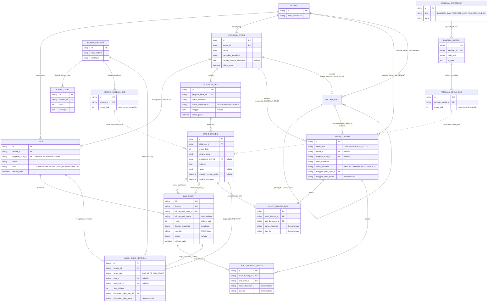
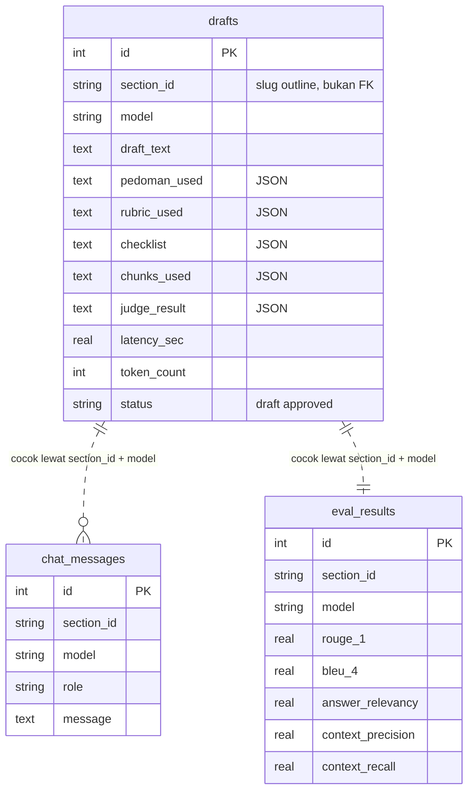
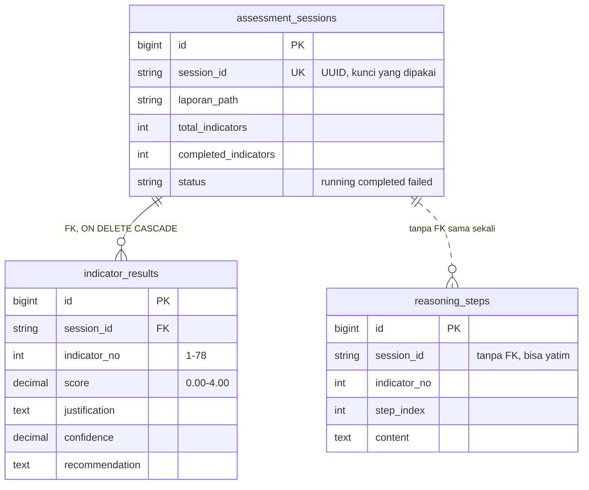
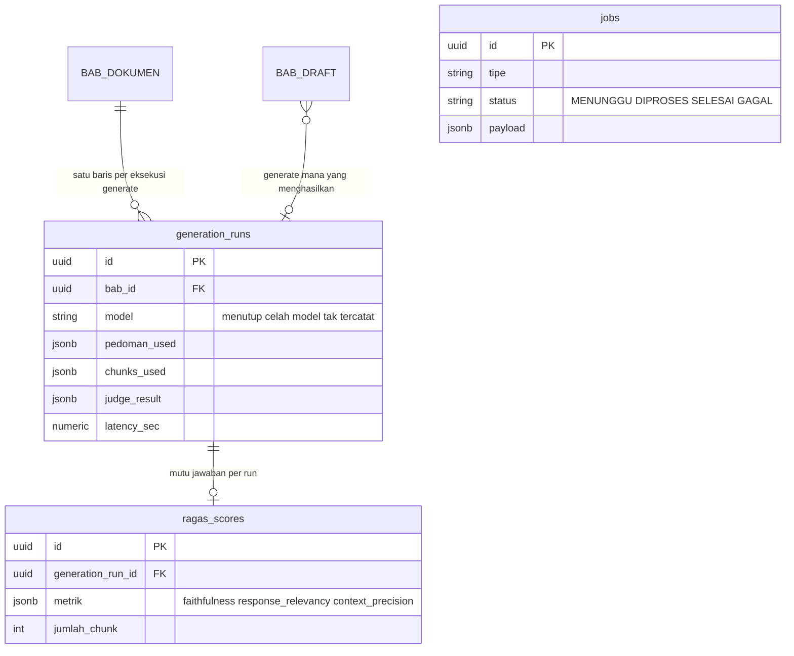

# ERD — Skema Database Platform LED

Diagram pendamping [`database.md`](./database.md). Kolom di sini sengaja **dipangkas** ke primary key, foreign key, dan satu-dua kolom penanda saja — rincian lengkap tiap kolom tetap di `database.md`. Tujuan halaman ini melihat **relasi**, bukan menghafal kolom.

**Cara membaca garis:**

| Garis | Arti |
|---|---|
| Utuh (`──`) | Foreign key sungguhan, ditegakkan database |
| Putus-putus (`⋯`) | Terhubung lewat **kecocokan nilai**, bukan FK — database tidak menjaganya |

---

## 1. Skema Utama (tabel 1–15 + 10a)

Status: **rancangan.** Belum ada satu pun migration fisik yang membuatnya.

**Dua hal yang tidak terlihat dari garis:**

- `RUBRIK_KRITERIA_BAB.urutan_bab` dan `PANDUAN_DETAIL_BAB.urutan_bab` **bukan** foreign key ke `BAB_DOKUMEN.id`. Keduanya master data global yang berlaku sebelum satu pun `DOKUMEN_LED` dibuat, jadi pencocokannya `WHERE urutan_bab = 2`, bukan JOIN.
- `HASIL_SKOR_KRITERIA` menempel ke **salah satu** `BAB_DOKUMEN` atau `BAB_DRAFT`, tidak pernah keduanya — ditentukan `target_tipe`. Pola yang sama dipakai `BUKTI_DUKUNG` lewat `owner_tipe`.

---

## 2. Prototipe AI-LED (tabel 16–18)

Status: **berjalan**, di SQLite `/data/led.db` pada branch `led-wiriting(dimas)`. Tidak punya satu pun foreign key, dan tidak tersambung ke skema utama.

`section_id` menunjuk simpul di pohon outline `led_bab_tabel.json` yang **berjenjang sampai 10 level** — bukan tabel, dan bukan `BAB_DOKUMEN.urutan_bab` yang cuma satu tingkat. Ini ketidakcocokan terbesar antara prototipe dan skema utama.

---

## 3. Prototipe AMI Assessment (tabel 19–21)

Status: **berjalan**, di Supabase PostgreSQL pada branch `ariel`. Punya FK internal, tapi tidak tersambung ke skema utama.

Teks kriteria tiap indikator **tidak ada di database** — di-*parse* dari Excel dan di-*cache* di memori, lalu digabungkan saat hasil dibaca.

---

## 4. Yang belum ada di mana pun

Tiga tabel diusulkan [`integration-plan.md`](./integration-plan.md) §2.4 tapi belum masuk `database.md` maupun kode:

`jobs` berdiri sendiri tanpa relasi — ia menggantikan Redis stream untuk MVP.

---

## Ringkasan status

| Kelompok | Jumlah tabel | Sudah jalan? | Tersambung ke skema utama? |
|---|---|---|---|
| Skema utama | 16 | ❌ rancangan | — |
| Prototipe AI-LED | 3 | ✅ SQLite | ❌ |
| Prototipe AMI | 3 | ✅ Supabase | ❌ |
| Usulan baru | 3 | ❌ belum ditulis | — |

Total yang harus ada di `schema.prisma` nanti: **25 tabel**.
